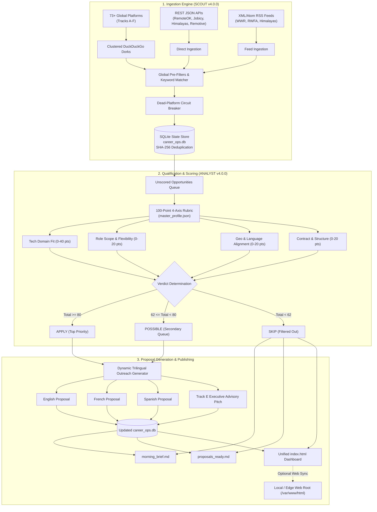

<div align="center">

# 🎯 Scout & Analyst v4.0.0
### Autonomous Multi-Track Career Pipeline & Trilingual Outreach Engine

**Declarative 73-Platform Lead Ingestion • 100-Point Multi-Axis Qualification • Grounded Multilingual (EN/FR/ES) Proposal Generation • Zero External Dependencies**

[](scout_agent.py)
[](scout_agent.py)
[](#-license)
[](career_ops.db)

[](platforms_config.json)
[](platforms_config.json)
[](master_profile.json)
[](proposals_ready.md)
[](index.html)

---

[**Explore Dashboard (`index.html`)**](index.html) • [**Morning Briefing (`morning_brief.md`)**](morning_brief.md) • [**Ready Proposals (`proposals_ready.md`)**](proposals_ready.md) • [**Platform Registry (`platforms_config.json`)**](platforms_config.json)

</div>

---

## 📖 Table of Contents

- [📌 Overview & Vision](#-overview--vision)
- [✨ Key Capabilities](#-key-capabilities)
- [🏗️ System Architecture](#️-system-architecture)
- [🗺️ 6-Track Radar Coverage (73 Platforms)](#️-6-track-radar-coverage-73-platforms)
- [📊 100-Point Qualification Rubric](#-100-point-qualification-rubric)
- [🚀 Quickstart & Offline Validation](#-quickstart--offline-validation)
- [🛠️ CLI Reference & Usage](#️-cli-reference--usage)
- [⚙️ Configuration Guide](#️-configuration-guide)
- [⏰ Automated Scheduling & Cron](#-automated-scheduling--cron)
- [🌐 Web Dashboard & Edge Distribution](#-web-dashboard--edge-distribution)
- [📂 Repository Structure](#-repository-structure)
- [📄 License](#-license)

---

## 📌 Overview & Vision

**Scout & Analyst** is a zero-dependency, dual-agent career automation system designed to eliminate manual job browsing, ungrounded cold outreach, and unstructured career prospecting.

Built entirely on the **Python 3.10+ Standard Library** with zero external packages (`pip install` not required), it runs autonomously on local machines, headless home servers, or cloud VPS instances:

```
┌────────────────────────────────────────────────────────────────────────┐
│                          SCOUT & ANALYST v4.0.0                        │
│                                                                        │
│   [73 Global Platforms] ──>  Agent 1: SCOUT  ──> [career_ops.db]       │
│                                (Ingestion)                             │
│                                                                        │
│   [master_profile.json] ──>  Agent 2: ANALYST ──> [morning_brief.md]   │
│                                (Scoring &)    ──> [proposals_ready.md] │
│                                (Generation)   ──> [index.html]         │
└────────────────────────────────────────────────────────────────────────┘
```

1. **`SCOUT`** acts as the discovery radar. It ingests opportunities from **73 global sources** spanning **6 strategic career tracks** using clustered search engine dorks, direct REST APIs, and XML/Atom feeds. It deduplicates entries via SHA-256 hashes into a persistent SQLite store (`career_ops.db`).
2. **`ANALYST`** acts as the qualification and proposal engine. It evaluates incoming leads against your [`master_profile.json`](master_profile.json) across a **100-point multi-axis rubric**, sorts opportunities into actionable verdicts (`APPLY`, `POSSIBLE`, `SKIP`), generates customized **English, French, and Spanish** outreach pitches, and builds a comprehensive interactive single-page dashboard ([`index.html`](index.html)).

---

## ✨ Key Capabilities

- **Zero External Dependencies:** Built with pure Python standard library modules (`urllib`, `sqlite3`, `json`, `re`, `hashlib`, `html`, `argparse`, `xml.etree.ElementTree`). No broken virtual environments, wheel compilation, or package bloat.
- **Clustered Search Portal Dorking:** Queries walled career portals (such as Outlier, Mercor, Turing, Toptal, and AngelList) by clustering up to 5 domains per search request, preventing HTTP 429/202 rate limits across 58+ portals.
- **Direct REST API & RSS Ingestion:** Native parsers for public JSON feeds (Working Nomads, Himalayas, Remotive, Jobicy, RemoteOK) and XML/Atom RSS feeds (We Work Remotely, Real Work From Anywhere).
- **Dead-Platform Circuit Breaker:** Inactive, shut-down, or blacklisted platforms are blocked upstream before initiating HTTP connections.
- **100-Point Multi-Axis Rubric:** Transparent, customizable scoring assessing Technical Fit (40 pts), Role Flexibility (20 pts), Geographic/Language Alignment (20 pts), and Contract Structure (20 pts).
- **Trilingual Outreach Suite:** Dynamically crafts ready-to-copy proposals in English, French, and Spanish, plus 60-Second Executive Advisory consultation pitches with an instant vendor scorecard.
- **Single-Page Reactive Dashboard:** Generates a lightweight, responsive [`index.html`](index.html) with zero frontend dependencies featuring real-time client-side search, track filters, verdict tabs, and one-click copy buttons.
- **Dual-Platform Automation:** Includes pre-configured installers for **Windows 11 Task Scheduler** ([`install_schedules.ps1`](install_schedules.ps1)) and **Linux systemd / cron** ([`install_schedules.sh`](install_schedules.sh)).

---

## 🏗️ System Architecture



---

## 🗺️ 6-Track Radar Coverage (73 Platforms)

The pipeline categorizes all discovery channels across six strategic tracks:

| Strategic Track | Scope & Category | Count | Sample Platforms & Connectors |
| :--- | :--- | :---: | :--- |
| **🤝 Track A** | **Direct B2B & Fractional MSP** | 6 | `Upwork (Managed Services & Cloud)`, `Intch`, `Contra`, `Wellfound (AngelList Talent)`, `Catalant`, `YunoJuno` |
| **🤖 Track B** | **AI Evaluation, RLHF & Technical Logic** | 20 | `Outlier AI`, `Alignerr`, `DataAnnotation.tech`, `Mindrift`, `Innodata`, `OneForma`, `Mercor`, `OpenTrain AI`, `Surge AI`, `Pareto AI`, `Micro1`, `RWS TrainAI`, `TELUS Digital`, `Peroptyx`, `TransPerfect DataForce`, `Welocalize`, `Appen CrowdGen`, `LXT`, `RemoExperts`, `Awesome AI Jobs` |
| **🌎 Track C** | **Vetted Global & Nearshore Networks** | 16 | `Toptal`, `Turing`, `Revelo`, `Lemon.io`, `Proxify`, `Braintrust`, `Arc.dev`, `Gun.io`, `Tecla`, `Strider`, `NeuronHire`, `HiresLink`, `Interfell`, `BairesDev`, `Nearsure`, `CloudDevs` |
| **🇫🇷 Track D** | **Francophone & European IT Marketplaces** | 9 | `Freelancermap`, `Free-Work (ex Freelance-Info)`, `LeHibou`, `Freelance-Informatique`, `Malt`, `Comet`, `Crème de la Crème`, `Codeur.com`, `9am.works` |
| **🎙️ Track E** | **Executive Expert Advisory Networks** | 6 | `GLG (Gerson Lehrman Group)`, `AlphaSights`, `Guidepoint`, `Dialectica`, `Wynter (B2B SaaS Panels)`, `Respondent.io` |
| **📡 Track F** | **Curated Remote-First & WFA Boards** | 16 | `Working Nomads API`, `Himalayas API & RSS`, `Remotive API`, `Jobicy API`, `RemoteOK API`, `We Work Remotely RSS`, `Real Work From Anywhere RSS`, `The Nonlinear Project`, `FlexJobs`, `Remote.co`, `4DayWeek.io`, `DevOpsProjectsHQ`, `FindJobIT`, `DistantJob`, `WOW Remote Teams` |

---

## 📊 100-Point Qualification Rubric

Every opportunity is scored on a normalized 0–100 scale configured in [`master_profile.json`](master_profile.json):

```
       TOTAL SCORE (100 pts) = Tech (40) + Flexibility (20) + Geo/Lang (20) + Contract (20)
```

| Axis | Max Points | Evaluation Criteria |
| :--- | :---: | :--- |
| **1. Technical & Domain Fit** | **40 pts** | Matches job title, tags, and description against your prioritized technology keywords (e.g. M365, Azure, Entra ID, Linux, Python, AI/RLHF, RMM/PSA stacks). Penalizes unlearned technology gaps. |
| **2. Role Scope & Flexibility** | **20 pts** | Rewards asynchronous autonomy, fractional contracts, self-paced evaluation, 4-day workweeks, and advisory scopes. |
| **3. Geographic & Language Alignment** | **20 pts** | Rewards remote eligibility (Worldwide, Global Remote, Americas, EMEA) and multilingual requirements (English, French, Spanish). |
| **4. Contract & Engagement Structure** | **20 pts** | Evaluates independent contractor alignment, hourly consultation ROI, and deducts placement caveats for strict 40h/wk full-time agency positions. |

### Verdict Categorization

- **🔥 `APPLY` (Score ≥ 80):** High-alignment opportunity. Immediately queued for outreach with tailored proposals generated in English, French, and Spanish.
- **🟡 `POSSIBLE` (Score 62–79):** Secondary or caveat role (e.g. full-time agency placement or partial stack match). Logged for review.
- **⏭️ `SKIP` (Score < 62):** Discarded from immediate view to preserve focus. Archived in SQLite for historical deduplication.

---

## 🚀 Quickstart & Offline Validation

### Prerequisites

- **Python 3.10+** (Python 3.10, 3.11, 3.12, 3.13, or 3.14)
- **Zero pip packages required**

### 1. Clone the Repository

```bash
git clone https://github.com/your-username/scout-analyst-pipelines.git
cd scout-analyst-pipelines
```

### 2. Verify with Offline Seed Data (Immediate Validation)

Run the pipeline offline without making any network requests to verify scoring and proposal generation:

```bash
# Seed verified 6-track baseline leads into career_ops.db
python scout_agent.py run --seed-verified --offline-only

# Score opportunities and compile reports
python analyst_agent.py --run
```

### 3. View the Outputs

Open the generated files in your preferred editor or browser:
- **`index.html`:** Open in any web browser (`file:///path/to/index.html`) for the interactive UI.
- **`morning_brief.md`:** Executive daily summary.
- **`proposals_ready.md`:** Copy-pasteable multilingual proposals.

---

## 🛠️ CLI Reference & Usage

### `scout_agent.py` — Ingestion Agent

```bash
# Run clustered search ingestion across all active platforms
python scout_agent.py run --mode clustered

# Run individual queries for deep diagnostics
python scout_agent.py run --mode individual

# Filter ingestion to a specific strategic track or platform
python scout_agent.py run --track "Track B"
python scout_agent.py run --platform "Outlier"

# List all 73 registered platforms grouped by track
python scout_agent.py list-platforms

# Declaratively register a new platform
python scout_agent.py add-platform \
  --name "Cloudflare Remote Jobs" \
  --type portal_dork \
  --url "https://www.cloudflare.com/careers/" \
  --track "Track F: Curated Remote-First & WFA Job Boards" \
  --query 'site:cloudflare.com ("Systems" OR "Cloud" OR "Remote")'

# Add a must-match keyword or a hard-exclude filter
python scout_agent.py add-keyword "kubernetes"
python scout_agent.py add-keyword "on-site only" --exclude
```

### `analyst_agent.py` — Qualification Agent

```bash
# Evaluate all unscored opportunities in career_ops.db
python analyst_agent.py --run

# Re-score all historical rows against an updated rubric
python analyst_agent.py --run --rescore-all

# Automatically deploy index.html to a custom web directory (e.g. Nginx)
python analyst_agent.py --run --web-dir /var/www/html
```

### `add_platforms.py` — Declarative Examples Helper

```bash
# Display CLI syntax examples for declaring feeds, dorks, and filters
python add_platforms.py

# Execute declarative examples demonstration
python add_platforms.py --demo
```

---

## ⚙️ Configuration Guide

Customizing the pipeline requires editing two JSON files:

### 1. [`master_profile.json`](master_profile.json)

Controls candidate metadata, language proficiencies, and scoring weights:

```json
{
  "candidate": {
    "name": "Alex Morgan",
    "title": "Senior Cloud & Systems Engineer | AI Technical Consultant",
    "location": "Remote (UTC-5 / EST)",
    "tax_status": "Independent Contractor / B2B Consultant",
    "portfolio": "https://portfolio.example.com",
    "email": "contact@example.com",
    "languages": {
      "EN": "Native / Fluent Professional Proficiency",
      "FR": "Professional Working Proficiency",
      "ES": "Professional Working Proficiency"
    }
  },
  "scoring_rubric": {
    "weights": {
      "tech_domain_max": 40,
      "role_flexibility_max": 20,
      "geo_language_max": 20,
      "contract_structure_max": 20
    },
    "high_value_tech_keywords": {
      "azure": 8,
      "m365": 9,
      "entra id": 10,
      "powershell": 8,
      "python": 8,
      "rlhf": 10
    },
    "unlearned_gap_penalties": {
      "kubernetes": -8,
      "rust": -8
    }
  }
}
```

### 2. [`platforms_config.json`](platforms_config.json)

Defines the 73 platform definitions, search queries, categories, and pre-filters:

```json
{
  "global_parameters": {
    "must_match_any_keyword": ["azure", "m365", "python", "cloud", "devops", "ai trainer"],
    "hard_exclude_keywords": ["tier 1 helpdesk", "cold calling", "secret clearance required"],
    "location_blacklist": ["us only", "must reside in the us", "uk only"]
  },
  "dead_platforms_blacklist": [
    {
      "name": "Stellar AI",
      "domain": "joinstellar.ai",
      "reason": "Wound down operations."
    }
  ]
}
```

---

## ⏰ Automated Scheduling & Cron

The repository includes pre-built installers to run the pipeline automatically on a recurring schedule.

### Windows 11 (Task Scheduler)

Runs Monday through Friday at 08:30 AM with battery resilience:

```powershell
powershell -ExecutionPolicy Bypass -File .\install_schedules.ps1
```

Registers two tasks:
1. **`CareerOps_01_ScoutAndAnalyst`:** Executes `scout_agent.py run --mode clustered` followed by `analyst_agent.py --run`.
2. **`CareerOps_02_MorningBriefOpen`:** Automatically opens the generated `index.html` and `morning_brief.md` at 08:45 AM.

### Linux / macOS (Cron & systemd)

Installs an hourly cron job (`0 * * * *`) or an optional systemd user timer:

```bash
chmod +x install_schedules.sh

# Install hourly cron job
./install_schedules.sh

# Or install as a systemd --user service and timer
./install_schedules.sh --systemd
```

---

## 🌐 Web Dashboard & Edge Distribution

The compiled [`index.html`](index.html) is an entirely self-contained single-page web application:

- **Zero CDN Dependencies:** Pure HTML5, CSS3, and vanilla JavaScript with embedded styles.
- **Client-Side Real-Time Filter:** Instant search box for filtering opportunities across titles, companies, tags, and notes.
- **Track & Verdict Selectors:** Instant pills to filter by strategic track (`TRACK A` through `TRACK F`) or verdict (`APPLY`, `POSSIBLE`, `SKIP`).
- **Interactive Proposal Drawer:** Switch between English, French, Spanish, and Executive Advisory proposals with one-click copy buttons.
- **Edge Deployment Ready:** Pass `--web-dir /var/www/html` to automatically publish updates to an Nginx, Apache, or Cloudflare Tunnel directory on every run.

---

## 📂 Repository Structure

```
scout-analyst-pipelines/
├── scout_agent.py          # Agent 1: 73-platform multi-track lead ingestion engine
├── analyst_agent.py        # Agent 2: 100-point scoring, trilingual proposals & web compiler
├── add_platforms.py        # Declarative platform CLI helper & syntax examples
├── master_profile.json     # Candidate profile, skills, scoring rubric & language signals
├── platforms_config.json   # 73 platform definitions, dorks, APIs, RSS & global filters
├── career_ops.db           # Persistent SQLite database with SHA-256 deduplicated records
├── index.html              # Standalone interactive single-page web dashboard
├── morning_brief.md        # Daily executive morning briefing report
├── proposals_ready.md      # Grounded copy-pasteable proposals (EN / FR / ES / Advisory)
├── pipeline.log            # Execution log output
├── install_schedules.ps1   # Windows 11 Task Scheduler automated installer
├── install_schedules.sh    # Linux cron & systemd user timer automated installer
├── .gitignore              # Standard git exclusions (pycache, env, logs)
└── README.md               # Project documentation
```

---

## 📄 License

This project is licensed under the **GNU General Public License v3.0 (GPL-3.0)** — see the [LICENSE](LICENSE) file or the header notices for details.
